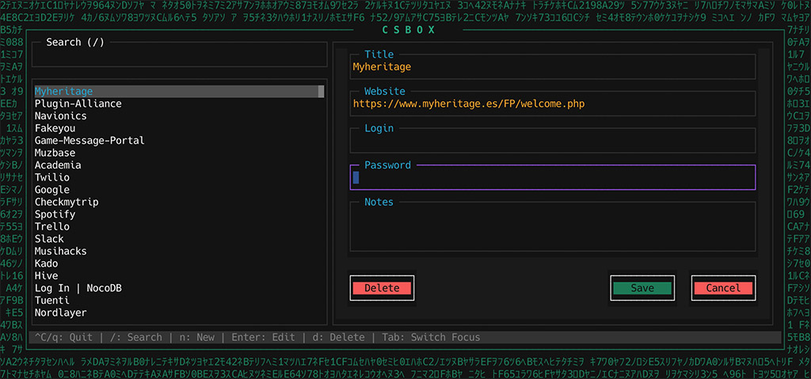

# 🔑 Csbox

**Csbox** is a modern terminal-based password manager, specially designed for users looking to migrate from the discontinued Dropbox Passwords service.

## Why Csbox?

Dropbox discontinued its password management service, leaving many users with exported CSV files containing all their passwords in **plain text**. This is a serious security risk, anyone who gains access to your computer or backups could read all your passwords without any barrier.

**Keeping an unencrypted CSV file with your passwords is extremely dangerous.** That's why I created Csbox: to provide a simple way to encrypt and manage those exported passwords locally.

Csbox allows you to:

- ✅ **Easily import** your exported Dropbox passwords (CSV format)
- ✅ **Strong encryption** using AES-256 to protect your data
- ✅ **Intuitive terminal interface** with keyboard navigation
- ✅ **Completely offline** - your passwords stay on your machine
- ✅ **Local encrypted database** secured with your master password



## Features

- 🔍 **Fast search** with real-time filtering
- 📝 **Full editor** to create, edit and organize your passwords
- 🎨 **Modern interface** with dark theme and custom colors
- ⌨️ **Keyboard shortcuts** for efficient navigation
- 💾 **Automatic encrypted saving**

## Installation

### Global Installation

```bash
npm install -g csbox
```

## Usage

### Import CSV from Dropbox

If you have a CSV file exported from Dropbox Passwords:

```bash
csbox exported_dropbox_accounts.csv
```

The program will ask for a **master password** that will be used to encrypt all your data. **Remember this password!** - without it you won't be able to access your accounts.

The CSV should have the following columns:
- `title` - Account title
- `website` - Website URL
- `login` - Username or email
- `password` - Password
- `otpSecret` - (Optional) Secret for OTP/2FA codes
- `notes` - (Optional) Additional notes

### Launch the Interface

To open the password manager:

```bash
csbox
```

Enter your master password to unlock the encrypted database.

## Keyboard Shortcuts

### General Navigation
- `/` - Open search
- `ESC` - Clear search / Close confirmation dialogs
- `n` - Create new account
- `d` - Delete selected account (with confirmation)
- `Enter` - Edit selected account
- `Tab` / `Shift+Tab` - Navigate between fields
- `↑` / `↓` - Navigate the list
- `Ctrl+C` / `q` - Quit

### In the Editor
- `Enter` - Go to next field
- `ESC` - Cancel editing
- `Tab` - Next field
- "Save" button - Save changes
- "Cancel" button - Discard changes
- "Delete" button - Delete current account (with confirmation)

## Security

- 🔒 **AES-256 encryption**: Your passwords are encrypted with your master password
- 🚫 **No cloud storage**: Everything is saved locally in `~/.csbox/db.json`
- 🔑 **Single master password**: You only need to remember one password
- 💻 **No internet connection**: Doesn't send data to any server

### ⚠️ Important

1. **Never lose your master password** - there's no way to recover your data without it
2. Make **regular backups** of the `~/.csbox/db.json` file
3. The database is stored in your home directory at `~/.csbox/db.json`
4. Use a **strong password** as your master password

### 🛡️ Security Disclaimer

This tool was created with the best intentions to help users protect their exported passwords. However, **I am not a security expert**. While I've implemented industry-standard AES-256 encryption and followed security best practices to the best of my knowledge, I cannot guarantee that this software is free from vulnerabilities.

**Use at your own risk.** I am not responsible for any data loss, security breaches, or other issues that may arise from using this software. If you have extremely sensitive data or require enterprise-level security guarantees, please consider using professionally audited password management solutions.

That said, using Csbox is **significantly safer than keeping your passwords in a plain text CSV file**.

**Note**: This project is not affiliated with Dropbox Inc. It is an independent tool created to help users manage their passwords locally after the discontinuation of the Dropbox Passwords service.

## File Structure

### Project Files
```
.
├── index.js            # Main entry point
├── ui.js               # User interface
├── persist.js          # Persistence layer with encryption
├── utils.js            # Utilities
└── theme.js            # Color configuration
```

### User Data
```
~/.csbox/
└── db.json        # Encrypted database (created automatically)
```

## Migrating from Dropbox Passwords

1. Export your passwords from Dropbox:
   - Open Dropbox Passwords
   - Go to Settings → Export
   - Save the CSV file

2. Import to Csbox:
   ```bash
   csbox exported_dropbox_accounts.csv
   ```

3. Enter a secure master password

4. Done! Your passwords are secure and ready to use

## Development

### Requirements
- Node.js 14 or higher

### Dependencies
- `blessed` - Terminal interface framework
- `crypto-js` - AES encryption
- `csv-parse` - CSV file parser
- `deepbase` - Simple file-based database

## 🤝 Contributing

Contributions are welcome! If you find any issues or have suggestions for improvement, please open an issue or submit a pull request on the [GitHub repository](https://github.com/clasen/Csbox).

## 📄 License

The MIT License (MIT)

Copyright (c) Martin Clasen

Permission is hereby granted, free of charge, to any person obtaining a copy of this software and associated documentation files (the "Software"), to deal in the Software without restriction, including without limitation the rights to use, copy, modify, merge, publish, distribute, sublicense, and/or sell copies of the Software, and to permit persons to whom the Software is furnished to do so, subject to the following conditions:

The above copyright notice and this permission notice shall be included in all copies or substantial portions of the Software.

THE SOFTWARE IS PROVIDED "AS IS", WITHOUT WARRANTY OF ANY KIND, EXPRESS OR IMPLIED, INCLUDING BUT NOT LIMITED TO THE WARRANTIES OF MERCHANTABILITY, FITNESS FOR A PARTICULAR PURPOSE AND NONINFRINGEMENT. IN NO EVENT SHALL THE AUTHORS OR COPYRIGHT HOLDERS BE LIABLE FOR ANY CLAIM, DAMAGES OR OTHER LIABILITY, WHETHER IN AN ACTION OF CONTRACT, TORT OR OTHERWISE, ARISING FROM, OUT OF OR IN CONNECTION WITH THE SOFTWARE OR THE USE OR OTHER DEALINGS IN THE SOFTWARE.

